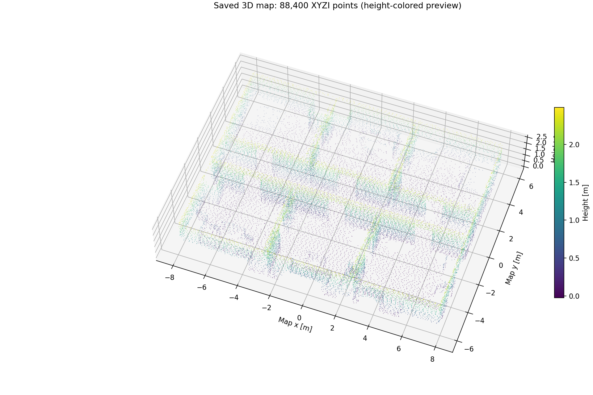
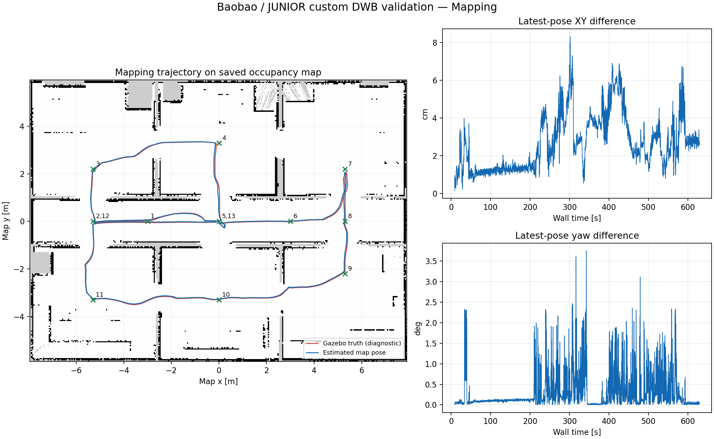
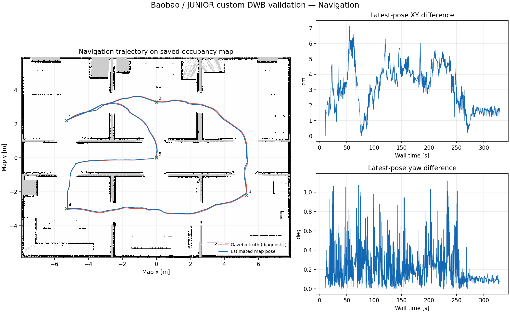

# Baobao：参考 JUNIOR dog_nav 的导航接入与 Gazebo 实测报告

日期：2026-11-17，Asia/Shanghai。工作空间：`/home/rain/ros_ws/baobao`。

## 1. 结论与交付范围

已将 `/home/rain/Desktop/驭灵工作记录/JUNIOR_DOG_WS/src/dog_nav` 的自定义 DWB 控制器、BPX 轨迹生成器和评分器接入本工作空间 `robot_navigation`，全局规划改为 SmacPlanner2D；机器人尺寸、差速运动约束、里程计和传感器坐标关系以 baobao 为准。保留 `bpx_startup_threshold: 0.21`。

实际完成 Gazebo 建图采集路线 **13/13 个目标成功**，保存新地图后重新启动定位与导航，最终 **5/5 个导航目标成功**；定位失联停车检查通过。全工作空间 **9 个包**完成 Release、symlink-install 编译，**38 个实际回归用例**通过。

这次结果说明该配置在本次室内场景中完成了建图和导航闭环，不能据此认定所有卡住问题已消除。过程中确实发生过启动门控等待、行人附近导航失败和频繁恢复，下文保留原始证据。最终导航仍有一个目标触发 6 次恢复，尚不适合宣称已经达到实机交付标准。

### 对“/opt 下 Nav2 不行”的核实

参考 `dog_nav` 本身也使用已安装的 Nav2 服务节点。影响本次行为的主要差别是控制器插件、轨迹采样、评分规则、行为树及参数组合；不能把问题直接归结为二进制位于 `/opt/ros/humble`。

本次运行已核对进程加载的库：

- `controller_server` 等基础服务仍来自 `/opt/ros/humble`。
- 控制器实际加载本工作空间编译的 `build/robot_navigation/librobot_navigation_dwb_plugins.so`。
- 全局规划实际加载 `/opt/ros/humble/lib/libnav2_smac_planner_2d.so`。

证据：[运行进程与库](navigation_processes.json)、[运行参数](navigation_live_parameters.json)、[参考源码一致性](source_manifest.json)。没有复制整套 Nav2 框架，也没有修改参考工作空间。

## 2. 架构与参数

```text
Gazebo LiDAR / IMU ──> FAST-LIO 前端 ──> 回环建图 / 保存 PCD 与二维地图
                     定位模式 ──> Open3D 地图定位 ──> map → odom
Gazebo 底盘里程计 ──> 本车 UKF / odom ──> odom → base_footprint
LiDAR 点云 ──> 现有 /scan 管线 ──> Nav2 障碍代价地图
二维地图 ──> SmacPlanner2D ──> 自定义 ParallelDwbLocalPlanner
                                      │
                                   /cmd_vel
                                      │
                       command_watchdog + 定位有效门控
                                      │
                                 /cmd_vel_safe ──> Gazebo 底盘
```

Gazebo 真值只用于事后诊断，没有送入 SLAM、定位或导航控制。

| 项目 | 本次配置 |
|---|---|
| 控制器 | `dog_nav::ParallelDwbLocalPlanner`，本地源码编译 |
| 轨迹生成器 | `dog_nav::BpxTrajectoryGenerator`，本地源码编译 |
| 自定义评分 | 缓存足迹碰撞、前进进度、接近目标运动约束、路径转向、稳定终点转向、侧向速度 |
| 全局规划 | `nav2_smac_planner/SmacPlanner2D` |
| 控制频率 | 15 Hz |
| 机器人基准 / 里程计 | `base_footprint` / `/odom` |
| 最大前进速度 / 最大控制器角速度 | 0.30 m/s / 0.60 rad/s |
| 横向 / 倒车 | `vy = 0`，`vy_samples = 1`，`min_vel_x = 0` |
| 足迹 | `[[0.24,0.25],[0.24,-0.25],[-0.24,-0.25],[-0.24,0.25]]`，padding 0.02 m |
| 目标容差配置 | XY 0.15 m、yaw 0.15 rad |
| 恢复行为 | 清图、旋转、等待；单目标和多目标 BT 均不自动倒车 |
| 命令链 | 直接发布 `/cmd_vel`，经过原有 watchdog 输出安全速度 |

移入的 8 个算法 `.cpp` 及配套头文件与参考内容一致，保留 `dog_nav` 内部命名空间以便追溯。配置和 launch 已按本车改写。源码见 [robot_navigation](../../src/robot_navigation/)，本轮快照见 [after](after/)，原有内容备份见 [before](before/)。

**没有照搬的部分：**四足机器人的 `nav_control` 偏置、侧移、0.9 m/s 限速、楼梯策略、硬件命令复用、音频和巡逻管理；也没有移入参考 `dog_sensors` 的点云过滤和 STVL 障碍管线。本次保留 baobao 现有 `/scan` 障碍层。因此这是针对本车的导航适配，不是整个参考平台的等价复制。

### BPX 0.21 的实际含义

参考实现检查：`sqrt(vx² + vy² + wz²) >= 0.21`，或允许零命令。这是参考固件约定的组合判据，混合了线速度和角速度的数值，**不是“每个非零线速度分量都至少 0.21 m/s”**。

生成器在正常加速度窗口还达不到阈值时，会加入幅值 0.21 的纯轴启动候选。保留此逻辑，并取消会把启动候选重新平滑到阈值以下的速度平滑器；watchdog 和定位失联停车仍保留。代价是启动命令可能直接跃迁，不能把常规加速度参数理解为所有输出变化的硬约束，实机仍需验证冲击、制动和电机响应。

Gazebo 差速插件没有模拟真实 BPX 固件死区；本次验证的是采样与发布命令符合阈值约定，不能证明实车必然能起步。

## 3. 测试条件与编译回归

- ROS 2 Humble；Gazebo Classic `11.10.2+dfsg-1`。
- `ros-humble-nav2-controller`：`1.1.20-1jammy.20260607.083252`；Smac：`1.1.20-1jammy.20260607.083248`。
- `house` 场景，3 名动态行人，seed 42，`sensor_noise_scale=1.0`，`lidar_downsample=5`。
- `gui=false`、`rviz=false`，通过真实 Gazebo、ROS 节点和 Nav2 action 执行，图像来自保存数据绘制，没有宣称做过 GUI 交互验证。
- 建图 ROS domain 71 / Gazebo master 11375；最终独立导航 domain 74 / master 11378。
- 传感器检查两阶段均通过：点云约 10 Hz、IMU 约 200 Hz、odom 约 50 Hz，均按仿真时间统计。估计实时因子分别为 0.843 / 0.834，运行耗时按墙上时间报告。

| 检查 | 结果 | 证据 |
|---|---|---|
| 全工作空间 Release + symlink-install | 9 包完成；存在非致命 PCL/CMake policy 警告 | [编译日志](build_all_final.log) |
| 导航与仿真测试目标编译 | 2 包完成 | [测试编译](build_tests_final.log) |
| 导航 C++ 回归 | 31 个 gtest 用例通过 | [执行日志](regression_tests_final.log)、[XML](test_results/robot_navigation/) |
| 行人净距逻辑 C++ 回归 | 3 个 gtest 用例通过 | [XML](test_results/robot_sim/) |
| 启动门控 Python 回归 | 4 个通过 | [执行日志](gate_regression_tests_final.log) |
| 传感器与行人运动 | 两阶段通过 | [建图检查](mapping_sensor_check.json)、[导航检查](navigation_sensor_check.json) |

共 38 个实际用例。`colcon test-result` 的 wrapper 计数与 gtest 用例数不同，不能将两者直接相加。源码、配置、模型和诊断脚本校验值见 [config_source_sha256.json](config_source_sha256.json)。

## 4. 建图实测与地图

最初尝试原有 `mapping_route`，前方净距达到约 0.25 m 后在第一个目标前安全退出；没有为完成路线降低停车阈值。随后启动自定义 Nav2 消费建图器实时 `/map`，由预设航点引导采集。这是有人监督的航点采图，不是自主探索。

两批目标全部返回 `SUCCEEDED`：

| 批次 | 路线（x,y，m） | 成功数 | 备注 |
|---|---|---:|---|
| 西北 | (-3,0) → (-5.3,0) → (-5.3,2.2) → (0,3.3) → (0,0) | 5/5 | 当时脚本未记录恢复次数 |
| 东南 | (3,0) → (5.3,2.2) → (5.3,0) → (5.3,-2.2) → (0,-3.3) → (-5.3,-3.3) → (-5.3,0) → (0,0) | 8/8 | 恢复次数依次 0、0、1、0、12、3、0、0 |

原始位置、朝向与各目标耗时：[西北目标](mapping_nav_goals_northwest.json)、[东南目标](mapping_nav_goals_east_south.json)。建图观测持续 629.61 s，包含等待和最初路线尝试，不能当成纯运动耗时。

保存返回 `success=True`，地图如下：

| 文件 / 指标 | 结果 |
|---|---|
| [full_map.pcd](map/full_map.pcd) | 88,400 个 XYZI 点 |
| [localization.pcd](map/localization.pcd) | 12,174 个定位地图点 |
| [occupancy.yaml](map/occupancy.yaml)、[occupancy.pgm](map/occupancy.pgm) | 317 × 237，分辨率 0.05 m |
| 已知 / 总栅格 | 70,706 / 75,129；其中占据 3,936 |
| 实际相机彩色点 | 0；本轮不是 RGB 建图 |

保存服务证据：[save_map.log](save_map.log)。虽然目录中保留了带 colored 名称的服务输出文件，但不能据其文件名认为有 RGB 数据。下图颜色仅按高度生成，预览截取约 -0.1 至 2.5 m 高度并稀疏显示，原始 PCD 保留在地图目录。





## 5. 独立加载新地图后的最终导航

停止建图及其 Nav2 实例，重新启动 Gazebo、地图定位和导航。最终 5 个目标均成功，action 状态均为 4：

| 序号 | 目标 x,y,yaw（m,m,rad） | 耗时（s） | 恢复次数 | 返回时最新估计 XY 与指定目标差（m） |
|---:|---|---:|---:|---:|
| 1 | -5.3, 2.2, 1.5708 | 61.48 | 6 | 0.077 |
| 2 | 0, 3.3, 0 | 31.94 | 0 | 0.111 |
| 3 | 5.3, -2.2, -1.5708 | 48.04 | 0 | 0.116 |
| 4 | -5.3, -3.0, 3.1416 | 78.10 | 2 | 0.107 |
| 5 | 0, 0, 0 | 41.52 | 0 | 0.168 |

总目标执行时间约 261.08 s，观测窗口 328.77 s。原始结果：[navigation_goals.json](navigation_goals.json)。

**不能把 action 成功等同于所有指定目标误差都小于 0.15 m。**末目标返回时，最新估计位姿距指定坐标约 0.168 m。规划路径终点容差、goal checker 所检查的路径终点与指定坐标的区别、TF/消息取样时刻差都可能影响这个诊断值；本轮未做严格同步和逐控制周期终点复核，原因没有被单独证实，后续应专项验证精确停靠。



### 定位与命令观测

| 诊断量 | 建图阶段 | 最终独立导航 |
|---|---:|---:|
| 最新估计位姿与 Gazebo 真值的 XY 差均值 | 2.67 cm | 3.14 cm |
| XY 差最大值 | 8.32 cm | 7.13 cm |
| 仅移动样本 XY 差均值 | 3.55 cm | 3.59 cm |
| yaw 差均值 / 最大值 | 0.00558 / 0.06547 rad | 0.00370 / 0.01987 rad |
| 机器人与行人中心最小观测距离 | 0.384 m | 0.587 m |

这是约 5 Hz 采样下的**诊断差值**：最新 TF 对比最新 `/gazebo/model_states`，没有严格按时间戳同步，也没有做轨迹刚体对齐。它包含消息延迟、取样差与估计差，不能作为标定过的定位精度指标。移动样本按相邻真值 XY / 采样仿真时间估计速度 >0.02 m/s 筛选，减少静止等待样本对均值的影响。统计见 [validation_summary.json](validation_summary.json)、[建图原始记录](mapping_metrics.json)、[导航原始记录](navigation_metrics.json)。原始诊断 JSON 由 Python 输出，初始化尚无有效定位时可能出现 `Infinity`，严格 JSON 解析器需先处理该值。

最终正常导航窗口中：

- `/cmd_vel` 收到 3,803 条，非零 3,453 条；组合量处于 0 与 0.21 之间的命令为 0 条；组合量为 0.21 的样本 64 条。
- `/cmd_vel_safe` 收到 6,569 条，非零 4,613 条；阈值以下非零命令同样为 0 条。watchdog 重发布造成两话题计数不同。
- 两话题最小非零组合量均为 0.21，最大 x 为 0.30，最大 yaw 为 0.60，所有观测 y 速度均为 0。
- 从采集器启动约 10.87 s 后进入 `TRACKING`，之后本轮未记录到 `LOST`。这不代表任意出生点和绑架恢复均已验证。
- 建图阶段最大 yaw 0.65 包含最初 `mapping_route` 的命令，不能据此称 DWB 超过其 0.60 配置。

中心距离不是底盘外轮廓到行人的净距，也没有记录接触传感器，因此不能据此证明无碰撞或满足人机安全距离。

## 6. 失败记录、修复及仍存风险

| 实际遇到的问题 | 证据与处理 |
|---|---|
| 原有采图路线前方过近停车 | [mapping_route.log](mapping_route.log)；未降低安全停车阈值，改由实时地图航点导航采图 |
| 首次 BT 激活等待不存在的 backup action | [初次 BT 日志](mapping_navigation_initial_bt_failure.log)；Humble 会初始化单点及多点导航树，补齐多点无倒车 BT |
| 已 TRACKING，但 Nav2 未激活 | [门控超时日志](initial_gate_timeout_navigation_launch.log)；watchdog 参数服务回复丢失后 future 一直未结束。加 3 s 重试；Nav2 启动回复 30 s 超时后先查询 navigator 状态，避免重复 configure；失败时继续禁止运动 |
| 首次进入行人区域后导航失败 | [目标结果](initial_pedestrian_deadlock_navigation_goals.json)：首目标成功，第二目标约 103.23 s 后 `ABORTED`，19 次恢复，余下未执行；[近障碍快照](navigation_block_diagnostic.json)中中心距约 0.348 m、前方 scan 最小约 0.260 m |

最后一项中发现行人仿真逻辑：只要下一步距机器人 <0.70 m 就禁止移动，导致已经处于该距离内的行人连逐步远离也做不到。修改为距离不足时阻止继续靠近，但允许增大净距的逃离步骤，并增加 3 个边界用例。没有删除行人、关闭碰撞或屏蔽其传感器回波。

**这只是其中一个确定的死锁因素。**机器人之前同样靠得过近，导航恢复效率也有问题，不能全部归咎于行人插件。最终 5/5 是修复行人逻辑后重新启动场景所得；虽使用相同 seed，时序与动态障碍轨迹仍不同，不能把前后结果当作严格 A/B 因果实验。

尚待验证或改进：

1. 恢复次数偏多：建图某目标 12 次、最终导航首目标 6 次；仍需针对行人让行、阻塞等待和局部规划滞留进行专项测试。
2. 近人净距：建图最小中心距约 0.384 m，早期失败轮约 0.348 m，风险真实存在；需要几何净距和接触监测，而非只看 action 成功。
3. 精确到点：最后一个目标差约 0.168 m，需要区分规划终点、goal checker 和时间同步影响。
4. 仅测试一个房屋场景与一个 seed；没有多 seed 长时间成功率、狭窄通道极限、拥挤对向会车、坡道/楼梯验证。
5. 没有与旧 RPP 进行相同环境下受控对比；不能定量声称新方案优于旧方案多少。
6. 未做实机 BPX 测试；启动跃迁、真实摩擦、制动、执行延迟及传感器时序仍需实测。
7. 保留 scan 障碍层而非参考 STVL 管线，低矮/悬空障碍覆盖不能按参考平台的能力推断。

## 7. 定位失联停车

最终正常导航数据采集结束后，单独执行 Gazebo 定位器心跳暂停故障注入。暂停过程中人为发布 0.1 m/s 命令，验证输出仍被禁止；该低速注入不计入前面的 BPX 正常导航命令统计。

- 13 条门控样本全部为 false。
- 30 条安全速度样本线速度、角速度均为 0。
- 恢复定位器后门控恢复。

证据：[localization_stop.json](localization_stop.json)、[执行日志](localization_stop.log)。脚本仅针对本工作空间仿真定位进程并在 finally 中恢复；这项测试不能代替实机急停与功能安全验证。

## 8. 复现方式

在干净终端中只加载本工作空间，不要叠加参考机器人工程。同一轮测试的全部终端设置相同 domain / Gazebo master。若端口已被占用，应统一换成其他未使用值。

```bash
cd /home/rain/ros_ws/baobao
source scripts/env.sh
export ROS_DOMAIN_ID=74
export GAZEBO_MASTER_URI=http://127.0.0.1:11378

# 先编译；可通过 CMAKE_BUILD_PARALLEL_LEVEL 控制内存占用
colcon build --symlink-install --cmake-args -DCMAKE_BUILD_TYPE=Release
source install/local_setup.bash

# 使用本轮新保存地图；gui/rviz 改 true 可打开界面
ros2 launch robot_slam simulation.launch.py \
  mode:=navigation \
  map_dir:=/home/rain/ros_ws/baobao/data/dog_nav_20261117_180453/map \
  scene:=house gui:=false rviz:=false \
  dynamic_pedestrians:=true pedestrian_count:=3 pedestrian_seed:=42 \
  sensor_noise_scale:=1.0 lidar_downsample:=5
```

在另一个设置了相同环境的终端发目标，避免同时从 RViz 或其他程序发送目标造成抢占：

```bash
python3 scripts/test_navigation_sim.py \
  --goals '[[-5.3,2.2,1.5707963268],[0,3.3,0],[5.3,-2.2,-1.5707963268],[-5.3,-3,3.1415926536],[0,0,0]]' \
  --timeout 180 --output /tmp/baobao_navigation_retest.json
```

重新建图时，先停止导航一整组 launch，再启动以下建图入口。第二个命令需在另一终端运行，等待 mapper 已发布有效 `/map` 与 `map → base_footprint` 后再执行。不要同时运行 `mapping_route`。

```bash
ros2 launch robot_slam simulation.launch.py mode:=mapping \
  gui:=false rviz:=false pedestrian_count:=3 pedestrian_seed:=42

# 另一终端：与建图使用相同 domain/master，并 source scripts/env.sh
ros2 launch robot_navigation navigation.launch.py use_live_map:=true

# 采图完成后指定新目录保存，避免覆盖本轮证据
./scripts/save_map.sh /home/rain/ros_ws/baobao/data/new_map
```

回归检查：

```bash
colcon build --symlink-install --packages-select robot_navigation robot_sim \
  --cmake-args -DCMAKE_BUILD_TYPE=Release -DBUILD_TESTING=ON
source install/local_setup.bash
colcon test --packages-select robot_navigation robot_sim --event-handlers console_direct+
colcon test-result --verbose
python3 scripts/test_navigation_gate.py
```

测试后已停止本轮启动的 Gazebo 和导航进程，记录的 launch PID 均不存在，见 [runtime.json](runtime.json)。不会在后台继续自动发目标。

## 9. 证据入口

- [地图目录](map/)、[建图轨迹](mapping_trajectory.png)、[最终导航轨迹](navigation_trajectory.png)、[点云预览](pointcloud_preview.png)。
- [导航启动日志](navigation_launch.log)、[建图启动日志](mapping_launch.log)、[建图期间 Nav2 日志](mapping_navigation_launch.log)。
- `initial_gate_timeout_navigation_*`：首次门控未启动成功的原始资料。
- `initial_pedestrian_deadlock_navigation_*`：行人附近中止轮次的原始资料。
- [统计补充](validation_summary.json)、[实际加载参数](navigation_live_parameters.json)、[实际加载库](navigation_processes.json)。
- [修改前备份](before/)、[修改后快照](after/)、[来源一致性](source_manifest.json)、[文件 SHA-256](config_source_sha256.json)。

所有完成率、耗时和差值仅对本报告列明的轮次有效；失败轮次没有混入最终 5/5 的分母，也没有被删除。
